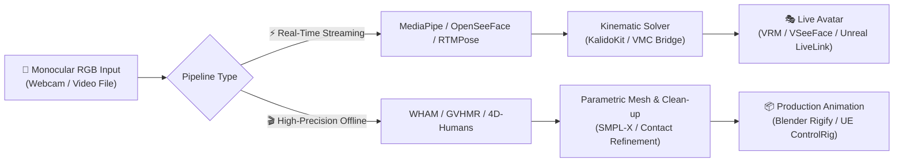

  

# 🕺 Awesome Monocular RGB Motion Capture & Webcam Tracking 🎥✨

  
  
  
  
  
  

---

## 🌟 Top Monocular RGB Motion Capture & Webcam Tracking Ecosystem 🚀

**Curated List of SaaS Products, Markerless AI Motion Capture Solutions & Open-Source GitHub Projects** 🌐  
*Focused on Single-Camera 3D Human Pose Estimation (HPE), Webcam Full-Body / Face / Hand Tracking, VTuber & VMC Streaming, 3D Mesh Recovery (SMPL/SMPL-X), and Video-to-MoCap Animation Pipelines.*

> 📅 **Last updated: November 2026**

This comprehensive index tracks industry-leading **SaaS cloud platforms** and cutting-edge **open-source repositories** for **Monocular RGB Motion Capture & Webcam Tracking**. These technologies reconstruct high-fidelity 3D skeletal poses, SMPL/SMPL-X parametric body meshes, facial blendshapes, and finger kinematics from ordinary webcams or single 2D RGB video streams. Outputs interface directly with **Blender**, **Unreal Engine**, **Unity**, and live **VTuber** avatars via VMC (Virtual Motion Capture) protocol—completely eliminating the barrier of expensive multi-camera suits or specialized optical hardware.

---

## 📑 Table of Contents

- [📊 Sector Overview & Market Dynamics](#-sector-overview--market-dynamics)
- [☁️ SaaS & Hosted Platforms](#️-saas--hosted-platforms)
- [💻 Open-Source GitHub Projects](#-open-source-github-projects)
- [🛠️ Frameworks & Zero-Suit Studio Workflows](#️-frameworks--zero-suit-studio-workflows)
- [🤝 How to Contribute](#-how-to-contribute)
- [💖 Support & Sponsorship](#-support--sponsorship)
- [📈 Star History](#-star-history)
- [⚠️ Disclaimer](#️-disclaimer)

---

## 📊 Sector Overview & Market Dynamics 📈

The global **markerless motion capture market** is valued at approximately **$80M–$90M** (with broader 3D motion capture and animation tracking software exceeding **$340M** and projected to surpass **$600M** by 2030, registering a robust CAGR of **~16.5%**). 

The industry demonstrates **moderate fragmentation across specialized tiers**: commercial CAD/VFX infrastructure is anchored by market behemoths like Autodesk (Flow Studio / Wonder Dynamics, valued at over **$60B+**), while single-camera cloud capture, indie gaming, and VTuber live-streaming remain dynamic and contestable, driven by agile VC-backed startups (Rokoko, DeepMotion, Plask) alongside viral open-source foundational research models (Google MediaPipe, Ultralytics, and academic SMPL-X/HMR frameworks).

---

## ☁️ SaaS & Hosted Platforms 🏢

*Commercial cloud-native markerless motion capture, video-to-animation suites, and auto-rigging platforms sorted in descending order by company valuation / scale.*

| SaaS Product | Company Scale / Valuation 🏢 | Starting Paid Tier Pricing 💳 | Free Tier / Trial Allowance 🎁 | Key Specialization & Capabilities 🎯 |
| :--- | :--- | :--- | :--- | :--- |
| [**Wonder Dynamics (Autodesk Flow Studio)**](https://wonderdynamics.com) | **~$62.8B Market Cap** *(Parent: Autodesk, $6.13B Rev)* | **$16.99 / mo** *(Lite tier, annual billing)* | **Free Plan**: 300 credits/mo, up to 720p export, 1GB storage, single-actor tracking | End-to-end cloud AI VFX platform: automatically tracks, animates, lights, and composites 3D CG characters into single-camera video |
| [**Reallusion ActorCore & AccuRIG**](https://reallusion.com) | **~$377M Market Cap** *(Public TPEx: 6882, ~$90M Rev)* | **$1.50 – $12.00 / motion** *(or ~$29/mo motion bundle)* | **AccuRIG 100% Free Forever**: Unlimited character auto-rigging & FBX/USD exports; free starter motion pack | Automated 3D character auto-rigging toolset paired with a vast cloud mocap library compatible with monocular pipelines |
| [**Rokoko Video & Studio**](https://rokoko.com) | **~$80M Valuation** *(~$15M raised, Naver Z backed)* | **$10.00 / mo** *(Basic tier, annual billing)* | **Free Starter**: 30 seconds AI video mocap per month, 5 Studio text-to-motion imports/mo, FBX export | AI webcam/video mocap integrated with Rokoko Studio, dual-camera tracking, and live-streaming plugins for Blender, UE, and Unity |
| [**Cascadeur Cloud & AI AutoPosing**](https://cascadeur.com) | **~$35M Est. Scale** *(Nekki, $1.5M+ dedicated R&D)* | **$19.00 / mo** *(Indie tier, or $8.25/mo billed annually)* | **Free Basic Plan**: Full physics & AI posing tools forever (non-commercial, saves in `.casc` format) | Physics-assisted 3D keyframe animation software with auto-posing deep learning models and secondary motion physics |
| [**Move.ai (Move One)**](https://move.ai) | **~$22M Est. Scale** *(Acq. by Oxford Metrics; $17.4M funding)* | **$15.00 / mo** *(Move One starter subscription)* | **Free Plan**: 30 free one-time credits, video recording clips up to 30 seconds | Single-camera iPhone markerless mocap extracting studio-grade 3D skeletal data with finger tracking into Blender, Maya, and Unreal |
| [**Kinetix**](https://kinetix.tech) | **~$15M Est. Scale** *(Acquired by Runway; $11.6M raised)* | **$20.00 / mo** *(Creator tier pay-as-you-go / SDK)* | **Free Community Tier**: Up to 30 free emote & animation generations per month | No-code cloud AI converting standard mobile/webcam videos into 3D character emotes, avatar animations, and virtual world assets |
| [**DeepMotion (Animate 3D)**](https://deepmotion.com) | **~$12M Est. Scale** *($2.2M raised, Bandai Namco backed)* | **$9.00 / mo** *(Starter tier, billed annually; or $15/mo)* | **Freemium Plan**: 25 credits per month (~10–15 sec mocap), non-commercial use with credit replenishment programs | Browser-based AI motion capture converting 2D video to 3D skeletal animation with physics simulation and foot-locking |
| [**Plask**](https://plask.ai) | **~$6M Est. Scale** *($2.56M raised, Smilegate backed)* | **$18.00 / mo** *(Standard tier, annual billing; or $28/mo)* | **Freemium Plan**: 15 seconds daily mocap limit (daily reset), 1 GB storage, full body & hand capture | Cloud AI motion capture with in-browser 3D keyframe editor and real-time retargeting for FBX, BVH, and GLB exports |
| [**Anything World (Anyworld)**](https://anyworld.ai) | **~$5M Est. Scale** *(Seed-stage AI 3D research startup)* | **$30.00 / mo** *(Micro tier, commercial export)* | **Free Tier**: 15–20 credits/mo, auto-rigging and AI animation preview (1 model download limit) | Generative 3D platform combining automated rigging, AI behaviors, and physics-driven character animation |
| [**RADiCAL Studio**](https://radicalmotion.com) | **Acquired Tech Asset** *(Acquired by Autodesk Flow)* | **$8.00 / mo** *(Legacy starter tier; now Flow Studio)* | **Free Trial / Tier**: 24 minutes lifetime processing credit, FBX web preview | Cloud-native real-time 3D motion capture platform streaming live monocular RGB skeletal tracking into 3D engines |

---

## 💻 Open-Source GitHub Projects 🛠️

*The most prominent open-source computer vision repositories, 3D human pose estimators, kinematic solvers, and webcam VTubing toolkits—sorted in descending order by GitHub_Stars ⭐.*

| Project & Repo Link | GitHub_Stars ⭐ | Primary Tracking Scope 🎯 | Runtime / Target Stack ⚡ | Description & Capabilities 📝 |
| :--- | :---: | :--- | :--- | :--- |
| [**Ultralytics YOLO11 / YOLOv8**](https://github.com/ultralytics/ultralytics) |  | 2D/3D Keypoints & Full-Body Pose | PyTorch, ONNX, TensorRT, CoreML | Ultra-fast real-time single-stage multi-person pose estimation on edge GPUs, CPUs, and mobile webcams (30–120+ FPS). |
| [**MediaPipe Holistic & Pose**](https://github.com/google-ai-edge/mediapipe) |  | Body (33), Hands (42), Face (478) | C++, Python, JavaScript, WebAssembly | Cross-platform real-time ML pipeline tracking full-body landmarks and facial blendshapes on standard webcams without dedicated GPUs. |
| [**OpenPose**](https://github.com/CMU-Perceptual-Computing-Lab/openpose) |  | Body, Face, Hands & Foot (135 pts) | C++, CUDA, OpenCV, Python | The pioneering real-time multi-person keypoint detection library from CMU for monocular RGB camera streams and recorded videos. |
| [**FreeMoCap**](https://github.com/freemocap/freemocap) |  | Full Body, Hands & 3D Triangulation | Python, Blender, MediaPipe | Free, open-source markerless motion capture suite supporting single-camera webcam capture as well as multi-camera spatial tracking. |
| [**AlphaPose**](https://github.com/MVIG-SJTU/AlphaPose) |  | Whole-Body Keypoints (136 pts) | PyTorch, CUDA, Python | Accurate real-time multi-person whole-body pose estimation and multi-object tracking system with foot, face, and hand joints. |
| [**MMPose (OpenMMLab)**](https://github.com/open-mmlab/mmpose) |  | Whole-Body, RTMPose, 2D/3D HPE | PyTorch, ONNX, TensorRT | Comprehensive open-source toolbox featuring state-of-the-art RTMPose for ultra-fast low-latency real-time webcam tracking. |
| [**KalidoKit**](https://github.com/yeemachine/kalidokit) |  | Kinematic Solver (Face, Pose, Hands) | TypeScript, JavaScript, WebGL | Lightweight browser-based kinematic solver converting MediaPipe 2D/3D raw landmarks into smooth VRM and Live2D joint rotations. |
| [**EasyMocap**](https://github.com/zju3dv/EasyMocap) |  | SMPL / SMPL-X Body & Hands | PyTorch, Python, OpenCV | Versatile research toolbox for monocular and multi-view 3D human motion capture and parametric human mesh reconstruction. |
| [**toyxyz_RGBMocap**](https://github.com/toyxyz/toyxyz_RGBMocap) |  | Full-Body MoCap & ExMR/GVHMR | Python, Windows, DirectML, CUDA | Standalone Windows monocular motion capture application integrating GVHMR, contact correction, retargeting, and FBX/VMD export. |
| [**VIBE**](https://github.com/mkocabas/VIBE) |  | SMPL Body Mesh & Video Inference | PyTorch, SMPL, CUDA | Adversarial learning framework generating temporally coherent 3D human body meshes directly from monocular in-the-wild video. |
| [**DWPose**](https://github.com/IDEA-Research/DWPose) |  | Whole-Body Keypoints (Two-Stage) | PyTorch, ONNX, ControlNet | High-accuracy whole-body pose estimator utilizing two-stage knowledge distillation; popular backbone for AI video generation. |
| [**SMPL-X**](https://github.com/vchoutas/smplx) |  | Unified Body, Face & Hand Model | PyTorch, NumPy | The academic gold standard 3D parametric expressive human model powering modern mesh recovery systems (WHAM, 4D-Humans, GVHMR). |
| [**GVHMR**](https://github.com/zju3dv/GVHMR) |  | World-Grounded Human Motion Recovery | PyTorch, CUDA, Gravity Coordinates | State-of-the-art monocular 3D human motion recovery system predicting drift-free global trajectories via gravity-view coordinates. |
| [**FrankMocap**](https://github.com/facebookresearch/frankmocap) |  | 3D Body + 3D Hand Integration | PyTorch, SMPL-X, OpenCV | Fast single-camera 3D hand and body pose estimator producing unified articulated meshes from standard video clips. |
| [**OpenSeeFace**](https://github.com/emilianavt/OpenSeeFace) |  | Facial Landmarks & Head Rotation | Python, ONNX, Unity, UDP/VMC | Highly optimized CPU-based facial tracking tool delivering real-time blendshapes and 6-DoF head pose for VTubing applications. |
| [**4D-Humans (HMR 2.0)**](https://github.com/shubham-goel/4D-Humans) |  | SMPL Mesh Reconstruction & Tracking | PyTorch, Transformers, ViT | Transformer-based 3D human mesh recovery model recovering pixel-accurate body rotations and trajectories from challenging video feeds. |
| [**HybrIK**](https://github.com/jeffffffli/HybrIK) |  | Analytical-Neural Inverse Kinematics | PyTorch, CUDA | Bridges 3D keypoint detection with analytical inverse kinematics to reconstruct realistic 3D human poses with natural joint limits. |
| [**ROMP**](https://github.com/Arthur151/ROMP) |  | One-Stage Multi-Person 3D Mesh | PyTorch, ONNX, C++ | Real-time monocular one-stage regression recovering multiple 3D human bodies and global positioning simultaneously (ROMP/BEV/TRACE). |
| [**HaMeR**](https://github.com/geopavlakos/hamer) |  | 3D Hand Mesh Recovery (MANO) | PyTorch, Vision Transformers | State-of-the-art transformer framework reconstructing intricate 3D hand poses and articulated finger meshes from monocular images. |
| [**WHAM**](https://github.com/yohanshin/WHAM) |  | World-Grounded 3D Motion & Foot Contacts | PyTorch, SLAM, SMPL | Reconstructs globally grounded 3D human motion from moving cameras while eliminating foot sliding via contact-aware refinement. |
| [**BlendArMocap**](https://github.com/cgtinker/BlendArMocap) |  | Blender Add-On Realtime Tracking | Blender Python, MediaPipe | Real-time motion tracking add-on for Blender converting webcam video directly into Rigify character keyframes and face rigs. |
| [**MocapNET**](https://github.com/FORTH-ModelBasedTracker/MocapNET) |  | 2D Keypoint to BVH Hierarchy | C++, OpenCV, Python | Real-time system estimating 3D skeletal poses directly in BVH format from 2D joint estimations for immediate animation pipeline import. |
| [**3DMPPE POSENET**](https://github.com/mks0601/3DMPPE_POSENET_RELEASE) |  | Distance-Aware 3D Multi-Person Pose | PyTorch, Python | Camera distance-aware top-down 3D multi-person pose estimation from single RGB images (ICCV). |
| [**EpipolarPose**](https://github.com/mkocabas/EpipolarPose) |  | Self-Supervised 3D Human Pose | PyTorch, Multi-View Geometry | Self-supervised 3D human pose estimator trained using multi-view geometric constraints without explicit 3D annotations (CVPR). |
| [**Kalidoface 3D**](https://github.com/yeemachine/kalidoface-3d) |  | Web VRM Avatar Webcam Tracking | Three.js, MediaPipe, KalidoKit | Web-based 3D VTuber app running full face, body, and hand tracking directly in the browser to animate VRM avatars in real time. |
| [**VRM Specification**](https://github.com/vrm-c/vrm-specification) |  | 3D Humanoid Avatar Standard | GLTF 2.0 Extension | Official standard specification for humanoid 3D avatar assets with blendshapes and spring bone physics for metaverse and VTubing. |

---

## 🛠️ Frameworks & Zero-Suit Studio Workflows 🎬

To build a professional, zero-suit motion capture studio from a single RGB webcam or video file:

1. **⚡ Real-Time Live Streaming (VTubers & Virtual Production)**:
   - Run **MediaPipe Holistic** or **OpenSeeFace** through **KalidoKit** or a **VMC (Virtual Motion Capture) OSC bridge**.
   - Stream smooth joint rotations and blendshapes directly into **VSeeFace**, **Unity**, or **Unreal Engine LiveLink** at 30–60 FPS.
2. **🎬 High-Fidelity Video Animation (Indie Devs & 3D Animators)**:
   - Process recorded RGB takes through **WHAM** or **GVHMR** to estimate drift-free global root translations and foot-ground locking.
   - Import generated SMPL-X or BVH takes into **Blender** using **BlendArMocap** or **ExpyKit** for retargeting onto custom game armatures.

---

## 🤝 How to Contribute 💡

Contributions from researchers, animators, and developers are warmly welcomed! 🌟

1. 🍴 **Fork** this repository.
2. 🌿 Create a feature branch (`git checkout -b feature/new-mocap-tool`).
3. 📝 Add or update entries in `README.md` adhering to the table format.
4. 🔗 Ensure all links, pricing details, and Stars_Counts are authentic and verified.
5. 🚀 Open a **Pull Request** with a concise description of your additions!

---

## 💖 Support & Sponsorship ☕

If this curated repository has accelerated your motion capture pipeline, helped your game development, or saved you hours of research, please consider supporting the project! Your generosity helps maintain, update, and expand this resource for the global open-source community:

- ⭐ **Star this repository** to improve visibility!
- 🍴 **Fork and share** with your network, fellow animators, and game devs!
- ☕ **Buy me a coffee & sponsor my work**: [**Sponsor Dashboard on GitHub**](https://github.com/sponsors/ishandutta2007)

  

Thank you to all community sponsors and contributors for making open-source 3D vision tools accessible to all! 💖✨

---

## 📈 Star History 📊

---

## ⚠️ Disclaimer 📜

- This repository is an independently curated community resource and does not constitute an official commercial endorsement.
- Monocular RGB motion capture is subject to inherent computer vision constraints including single-view depth ambiguity and self-occlusions; applying inverse-kinematic constraints and temporal filtering is advised for high-end cinematic production.
- Parametric human body models (such as `SMPL` and `SMPL-X`) possess specific academic vs. commercial licensing restrictions; always review model agreements prior to commercial deployment.
